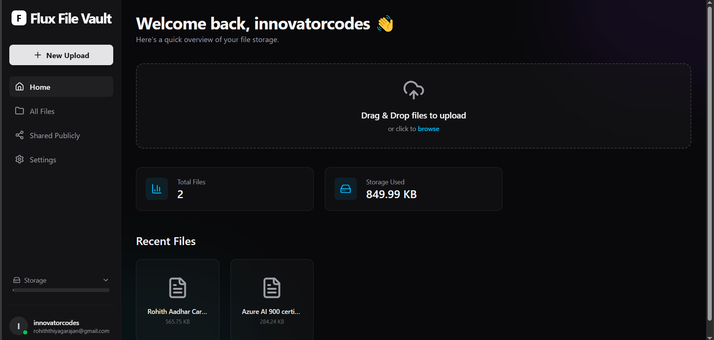
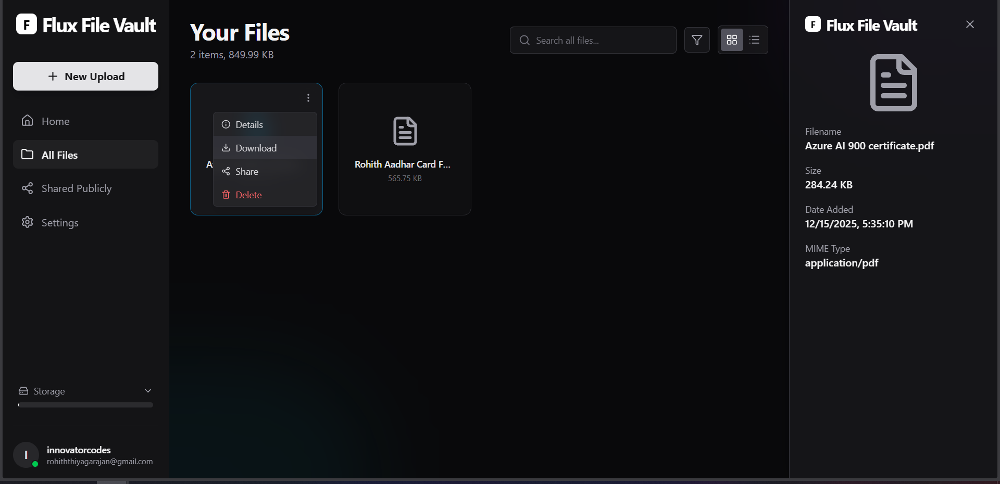
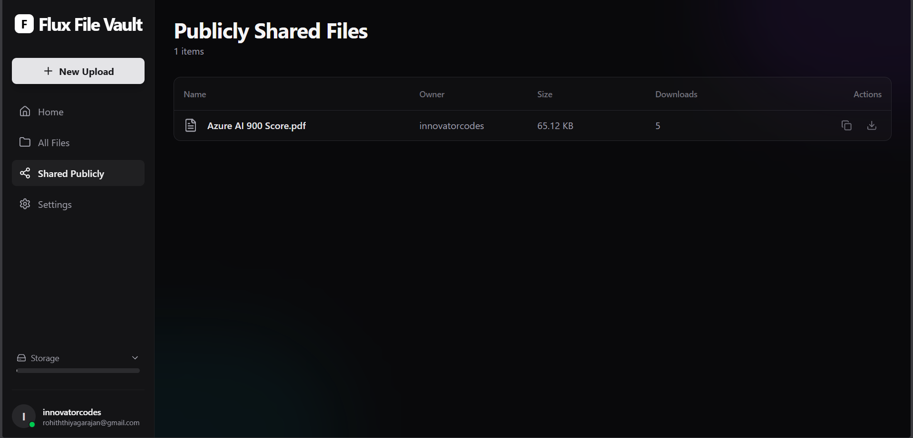
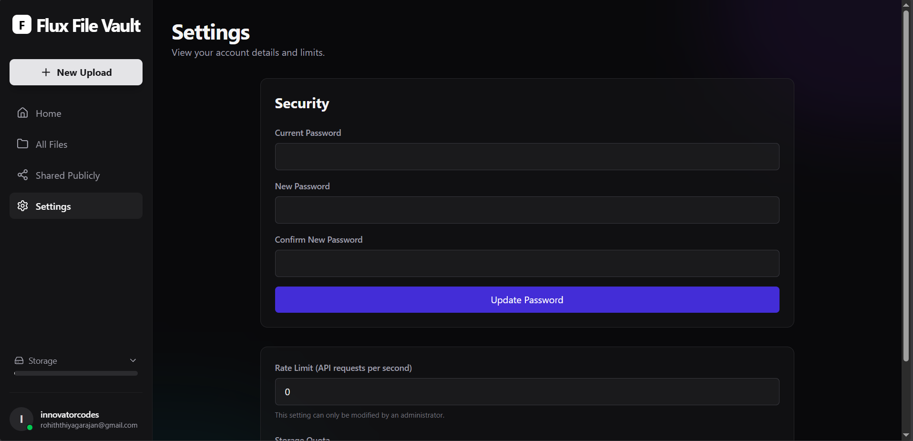

# Flux File Vault

**Flux** is a secure, high-performance file storage and sharing platform designed for privacy, speed, and efficiency. Built with a modern tech stack, it features intelligent file deduplication, granular user management, and secure public sharing capabilities.

## ✨ Key Features

-   **🛡️ Secure Storage**: Robust file storage powered by **Supabase**.
-   **💾 Smart Deduplication**: Intelligent content-addressable storage ensures identical files are stored only once, saving significant space.
-   **🔗 Secure Sharing**: Generate public share links with download tracking, and turn them off at any time.
-   **⚡ High Performance**: Backend powered by **Go (Gin)** for blazing fast API responses.
-   **👤 User Management**: Per-user storage quotas and rate limits, plus an admin view of every user's files.
-   **📦 One-Container Deploy**: The Go server also serves the built React app, so the whole project ships as a single Docker image.

## 🛠️ Tech Stack

-   **Backend**: Go (Golang), Gin Web Framework
-   **Frontend**: React, TypeScript, Tailwind CSS, Framer Motion, Vite
-   **Database & Storage**: Supabase (PostgreSQL via PostgREST, Storage)
-   **Security**: bcrypt password hashing, signed JWT sessions, per-user rate limiting, Row Level Security (RLS) blocking the public key

## 📸 Screenshots

### Home Page


### Files View


### Publicly Shared Files


### Settings


## 🚀 Getting Started

Follow these instructions to set up the project locally.

### Prerequisites

-   [Go](https://go.dev/) (1.21+)
-   [Node.js](https://nodejs.org/) (18+)
-   [Supabase Account](https://supabase.com/)

### 1. Supabase Setup

1.  Create a new project in Supabase.
2.  **Database**: Open the Supabase SQL Editor and run [`schema.sql`](./schema.sql) from the project root. It creates the `users`, `file_contents`, `files` and `shares` tables.
3.  **Storage**: Nothing to do. The server creates a **private** bucket named **`file-vault-storage`** on first start. (All downloads go through the API, which checks permissions, so the bucket must not be public.)
4.  **Admin (optional)**: after signing up, run `update users set is_admin = true where email = 'you@example.com';` in the SQL Editor.

### 2. Backend Configuration

1.  Navigate to the backend directory:
    ```bash
    cd backend
    ```
2.  Create a `.env` file in `backend/` with your credentials:
    ```env
    SUPABASE_REST_URL=https://your-project-id.supabase.co/rest/v1
    SUPABASE_STORAGE_URL=https://your-project-id.supabase.co/storage/v1
    SUPABASE_KEY=your_service_role_key__not_anon
    JWT_SECRET=a_long_random_string   # e.g. output of: openssl rand -hex 32

    # Optional
    PORT=8080
    MAX_UPLOAD_MB=50       # largest single upload
    DEFAULT_QUOTA_MB=25    # storage for each new account
    DEMO_ACCOUNT=true      # adds a "Try the demo" button that needs no sign-up
    ```
3.  Run the server:
    ```bash
    go run ./cmd/server
    ```
4.  Run the tests (no Supabase needed):
    ```bash
    go test ./...
    ```

### 3. Frontend Configuration

1.  Navigate to the frontend directory:
    ```bash
    cd frontend
    ```
2.  Install dependencies:
    ```bash
    npm install
    ```
3.  Start the development server:
    ```bash
    npm run dev
    ```
4.  Open your browser at `http://localhost:5173`. Vite forwards `/api` requests to the Go server on port 8080.

### 4. Production build (one server)

The Go server can also serve the built frontend, so the whole app runs on one address with no CORS setup:

```bash
cd frontend && npm run build          # outputs frontend/dist
cd ../backend && STATIC_DIR=../frontend/dist go run ./cmd/server
```

Then open `http://localhost:8080`.

## ☁️ Deployment

The included `Dockerfile` builds the frontend and backend into one image, and `render.yaml` deploys it to [Render](https://render.com) for free.

1.  Set up Supabase as in step 1 above.
2.  Push this repo to GitHub.
3.  In Render: **New → Blueprint**, pick the repo, and fill in `SUPABASE_REST_URL`, `SUPABASE_STORAGE_URL` and `SUPABASE_KEY` when asked. `JWT_SECRET` is generated for you, and the demo account and a 25 MB per-account quota are switched on.
4.  Wait for the build, then open the `.onrender.com` URL Render gives you.

Free-tier notes: the Render service sleeps after about 15 minutes without traffic, so the first visit after that takes 30–60 seconds. Supabase pauses free projects after a week with no activity.

To test the image locally:

```bash
docker build -t file-vault .
docker run --env-file backend/.env -p 8080:8080 file-vault
```

For a full explanation of how the project works, see [ARCHITECTURE.md](./ARCHITECTURE.md).

## 🤝 Contributing

Contributions are welcome! Please feel free to submit a Pull Request.
